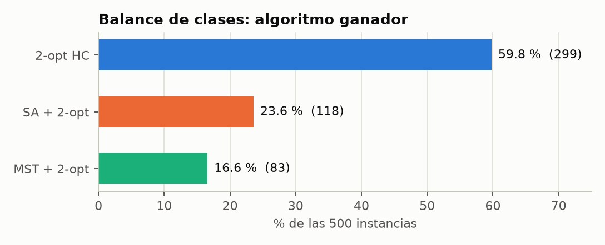
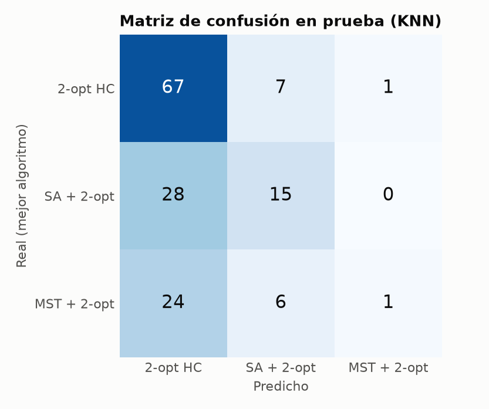
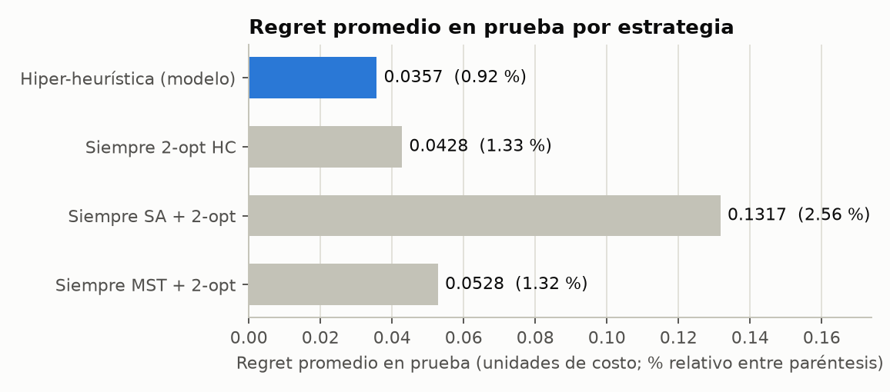
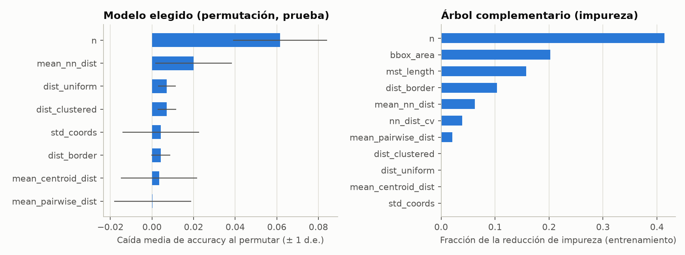
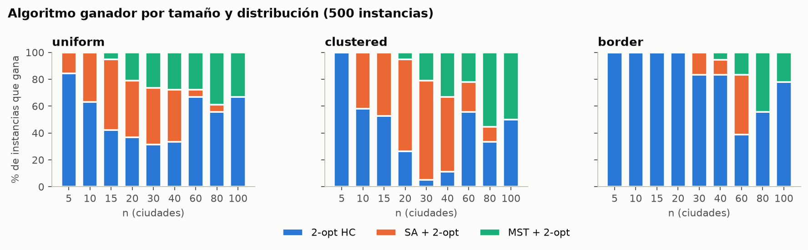
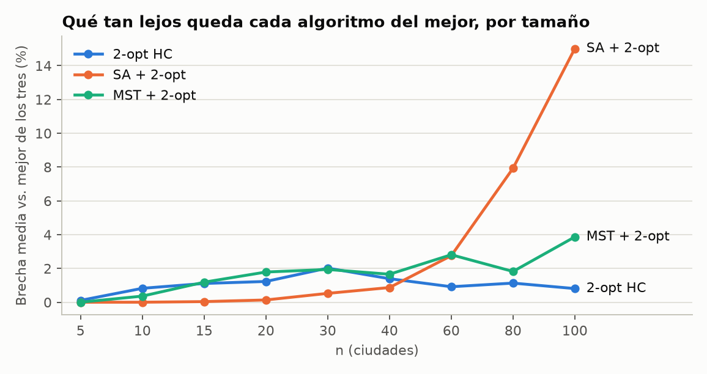

# Proyecto Final: Hiper-heurística de Selección para TSP

Repositorio: https://github.com/abyssace/hiperheuristica

## Resumen

Se corrieron los tres algoritmos de Tarea 2 (2-opt hill climbing, recocido simulado con movimiento 2-opt y MST + 2-opt) sobre las 500 instancias provistas y se entrenó un clasificador que predice cuál gana en una instancia nueva.

- **Balance de clases propio:** 2-opt HC gana 59.8 %, SA + 2-opt 23.6 % y MST + 2-opt 16.6 % de las 500 instancias.
- **Modelo elegido (por validación cruzada en entrenamiento):** KNN con k = 31 sobre las características provistas estandarizadas.
- **Accuracy en prueba:** 55.7 % contra 50.3 % del baseline trivial (predecir siempre 2-opt HC). La mejora es de 5.4 puntos, pero con 149 instancias no es estadísticamente concluyente.
- **Regret promedio en prueba:** 0.0357 (0.92 % del mejor costo) contra 0.0428 (1.33 %) de usar siempre 2-opt HC: 17 % menos regret.
- **Limitación principal:** el modelo detecta parte de las victorias de SA (recall 35 %), pero prácticamente no detecta las de MST + 2-opt (recall 3 %).

## 1. Etiquetado: cómo se corrieron los algoritmos

Los algoritmos son los de Tarea 2, copiados sin cambios del repositorio `abyssace/algoritmia` (commit `a5daffc`) a `src/tarea2_algorithms.py`. El script `src/label_instances.py` los corre sobre cada instancia:

| Algoritmo | Cómo se corre |
|---|---|
| 2-opt hill climbing | `two_opt` (first-improvement hasta óptimo local) desde un tour aleatorio. |
| SA + 2-opt | `simulated_annealing` con movimiento 2-opt aleatorio, desde el mismo tour aleatorio que 2-opt HC. Se reporta el mejor costo visitado. |
| MST + 2-opt | `mst_preorder_tour` (recorrido preorder del MST, Prim) mejorado con `two_opt`. |

### Parámetros de SA (parte del etiquetado)

| Parámetro | Valor |
|---|---|
| Esquema de enfriamiento | Exponencial: T_k = T0 · (Tf / T0)^(k / (K − 1)) |
| Temperatura inicial T0 | 0.05612504500232145 (5.6125 de Tarea 2, dividido entre 100) |
| Temperatura final Tf | 0.0002 (0.02 de Tarea 2, dividido entre 100) |
| Iteraciones K | 15 000 por instancia, igual para todos los tamaños |
| Vecindario | Un movimiento 2-opt aleatorio por iteración |
| Aceptación | Metropolis: se acepta si Δ < 0 o con probabilidad exp(−Δ / T) |

T0 = 5.6125 es el nivel seleccionado en el experimento de sintonización de temperatura (DOE) de Tarea 2, con enfriamiento exponencial, Tf = 0.02 y 15 000 iteraciones. Ese experimento usó coordenadas en [0, 100]² y este dataset usa [0, 1]². Por eso ambas temperaturas se dividen entre 100: así la probabilidad de aceptación exp(−Δ / T) es exactamente la misma que si se escalaran las coordenadas por 100 y se usaran las temperaturas originales.

### Otras decisiones del etiquetado

- **Semillas:** cada instancia usa semillas fijas derivadas de su número (`SEED = 20261119`), así que el etiquetado es reproducible. Cada algoritmo se corre una sola vez por instancia.
- **Empates:** dos costos se consideran iguales si difieren en menos de 1e-9. El empate se resuelve por orden fijo: 2-opt HC, luego SA + 2-opt, luego MST + 2-opt. La columna `n_tied_best` guarda cuántos algoritmos empatan en el mínimo.
- **Columnas agregadas:** `cost_2opt_hill_climbing`, `cost_sa_2opt`, `cost_mst_2opt`, `best_algorithm`, `n_tied_best` y los tiempos de cada algoritmo. Los archivos etiquetados están en `data/labeled/`.

Los empates importan: en 45.2 % de las instancias al menos dos algoritmos llegan al mismo tour. Ocurre en 98 % de las instancias con n = 5 y en 0 % con n = 100. En esas instancias la etiqueta la decide la regla de desempate, no una diferencia real de desempeño, y eso infla la clase 2-opt HC en tamaños chicos.

## 2. Balance de clases

| Algoritmo ganador | Total (500) | % | Entrenamiento (351) | Prueba (149) |
|---|---|---|---|---|
| 2-opt hill climbing | 299 | 59.8 % | 224 (63.8 %) | 75 (50.3 %) |
| SA + 2-opt | 118 | 23.6 % | 75 (21.4 %) | 43 (28.9 %) |
| MST + 2-opt | 83 | 16.6 % | 52 (14.8 %) | 31 (20.8 %) |



El **baseline trivial** es predecir siempre 2-opt hill climbing, la clase más frecuente en entrenamiento. En prueba acierta **50.3 %** (75 de 149). La partición es estratificada por (n, distribución) pero no por etiqueta, y en prueba 2-opt HC gana menos que en entrenamiento (50.3 % contra 63.8 %).

Si solo se cuentan las 274 instancias sin empate, las clases quedan casi balanceadas: 2-opt HC 102, SA + 2-opt 89 y MST + 2-opt 83.

## 3. Modelo e hiperparámetros

**Características.** Se probaron dos conjuntos:

- *Provistas* (8): `n`, `mean_pairwise_dist`, `std_coords`, `mean_centroid_dist`, `mean_nn_dist` y la distribución codificada one-hot.
- *Provistas + calculadas* (11): las anteriores más tres calculadas de las coordenadas: `nn_dist_cv` (coeficiente de variación de la distancia al vecino más cercano), `mst_length` (longitud del MST) y `bbox_area` (área de la caja envolvente).

**Selección.** Se compararon Árbol de Decisión, KNN y Random Forest con búsqueda en malla y validación cruzada estratificada de 5 pliegues, usando solo el conjunto de entrenamiento. El conjunto de prueba se usó una sola vez, al final.

| Modelo | Características | Accuracy CV (± d.e.) | Mejores hiperparámetros |
|---|---|---|---|
| **KNN** | **provistas** | **0.672 ± 0.027** | **k = 31, pesos uniformes** |
| Random Forest | provistas | 0.664 ± 0.028 | max_depth = 5, min_samples_leaf = 5 |
| Árbol de decisión | provistas + calculadas | 0.664 ± 0.021 | entropy, max_depth = 5, min_samples_leaf = 20 |
| Random Forest | provistas + calculadas | 0.661 ± 0.034 | max_depth = 5, min_samples_leaf = 10 |
| Árbol de decisión | provistas | 0.655 ± 0.029 | gini, max_depth = 3, min_samples_leaf = 20 |
| KNN | provistas + calculadas | 0.653 ± 0.030 | k = 31, pesos por distancia |

**Modelo final: KNN** con `n_neighbors = 31`, `weights = "uniform"`, distancia euclidiana y `StandardScaler` previo, sobre las 8 características provistas. Se eligió por tener la mayor accuracy de validación cruzada. Las seis configuraciones quedan dentro de una desviación estándar entre sí, así que la validación cruzada no distingue con claridad un ganador. Las características calculadas no mejoraron de forma consistente. Random Forest se exploró como alternativa de ensamble y no superó a los modelos sugeridos.

## 4. Evaluación en el conjunto de prueba

### Accuracy contra el baseline

| Estrategia | Accuracy en prueba |
|---|---|
| Baseline trivial (siempre 2-opt HC) | 50.3 % (75 / 149) |
| **Hiper-heurística (KNN)** | **55.7 % (83 / 149)** |

El modelo supera al baseline por 5.4 puntos (8 instancias). El intervalo de confianza de 95 % de la accuracy es de ± 8.0 puntos, así que la mejora no es estadísticamente concluyente. La accuracy balanceada es 42.5 % (el baseline tiene 33.3 %).

La accuracy en prueba (55.7 %) es menor que la de validación cruzada (67.2 %). La causa principal es que en prueba la clase mayoritaria pesa menos (50.3 % contra 63.8 %) y el modelo predice 2-opt HC en 80 % de los casos.

### Matriz de confusión

| Real \ Predicho | 2-opt HC | SA + 2-opt | MST + 2-opt | Recall |
|---|---|---|---|---|
| 2-opt HC (75) | 67 | 7 | 1 | 89.3 % |
| SA + 2-opt (43) | 28 | 15 | 0 | 34.9 % |
| MST + 2-opt (31) | 24 | 6 | 1 | 3.2 % |
| **Total predicho** | 119 | 28 | 2 | |



### Regret

El regret de una instancia es el costo del algoritmo elegido menos el costo del mejor algoritmo real en esa instancia. Los costos son longitudes de tour en el cuadrado unitario.

| Estrategia | Regret promedio | Regret relativo promedio | Regret máximo | % con regret cero |
|---|---|---|---|---|
| **Hiper-heurística (KNN)** | **0.0357** | **0.92 %** | 0.474 | 58.4 % |
| Siempre 2-opt HC (baseline) | 0.0428 | 1.33 % | 0.474 | 50.3 % |
| Siempre MST + 2-opt | 0.0528 | 1.32 % | 1.561 | 63.1 % |
| Siempre SA + 2-opt | 0.1317 | 2.56 % | 2.511 | 64.4 % |
| Elección al azar (1000 repeticiones) | 0.0766 | | | |
| Oráculo | 0 | 0 % | 0 | 100 % |



El regret promedio de la hiper-heurística es **0.0357**, 17 % menor que el del baseline. La mediana es 0 en todas las estrategias.

La columna "% con regret cero" muestra el efecto de los empates. Usar siempre SA o siempre MST elige un algoritmo co-óptimo más veces que el modelo (64.4 % y 63.1 % contra 58.4 %), porque empatan con el mejor en casi todas las instancias chicas. Aun así tienen mayor regret promedio, porque cuando fallan lo hacen por mucho: SA en instancias grandes, donde 15 000 iteraciones no alcanzan. El modelo falla por menos.

### Resultados por tamaño y distribución

| n | 5 | 10 | 15 | 20 | 30 | 40 | 60 | 80 | 100 |
|---|---|---|---|---|---|---|---|---|---|
| Instancias de prueba | 18 | 18 | 18 | 18 | 17 | 15 | 15 | 15 | 15 |
| Accuracy | 83 % | 61 % | 61 % | 78 % | 47 % | 40 % | 33 % | 33 % | 53 % |
| Regret promedio | 0.006 | 0.020 | 0.025 | 0.021 | 0.054 | 0.021 | 0.070 | 0.079 | 0.036 |

| Distribución | Instancias de prueba | Accuracy | Regret promedio |
|---|---|---|---|
| border | 49 | 75.5 % | 0.009 |
| clustered | 50 | 52.0 % | 0.022 |
| uniform | 50 | 40.0 % | 0.076 |

## 5. Análisis

### ¿Qué características son más importantes?



KNN no tiene importancias internas, así que se midió la importancia por permutación en prueba: cuánto cae la accuracy al permutar cada característica (200 repeticiones).

| Característica | Caída de accuracy (± d.e.) |
|---|---|
| `n` | 0.062 ± 0.023 |
| `mean_nn_dist` | 0.020 ± 0.018 |
| `dist_uniform` | 0.007 ± 0.004 |
| `dist_clustered` | 0.007 ± 0.004 |
| `std_coords` | 0.004 ± 0.018 |
| `dist_border` | 0.004 ± 0.005 |
| `mean_centroid_dist` | 0.003 ± 0.018 |
| `mean_pairwise_dist` | 0.000 ± 0.019 |

**El tamaño `n` es la característica más importante**, y la única cuya importancia se separa claramente de cero. Le sigue `mean_nn_dist`, que está muy correlacionada con `n` (más ciudades implica vecinos más cercanos). La distribución aporta poco pero de forma consistente. Las tres medidas de dispersión global (`std_coords`, `mean_centroid_dist`, `mean_pairwise_dist`) no aportan de forma distinguible del ruido.

Como complemento se ajustó un árbol de decisión (el mejor árbol según validación cruzada, con las 11 características). Coincide en que `n` domina (41 % de la reducción de impureza), seguido de `bbox_area` (20 %), `mst_length` (16 %) y `dist_border` (10 %). Sus reglas se resumen así: con n ≤ 17 predice 2-opt HC; con n entre 18 y 50 y caja envolvente chica (instancias agrupadas) predice SA; en el resto predice 2-opt HC. El árbol completo está en `results/decision_tree.txt`.

### ¿El modelo identifica dónde SA o MST + 2-opt superan a 2-opt, o colapsa?

**Colapsa parcialmente.** Predice 2-opt HC en 119 de 149 instancias de prueba (80 %), aunque solo gana en 50 %.

- **SA + 2-opt: lo identifica en parte.** Recupera 15 de 43 victorias de SA (recall 35 %) y, cuando predice SA, acierta 15 de 28 (precisión 54 %). Casi todas esas predicciones (25 de 28) caen en instancias agrupadas, y 19 de 28 en tamaños de 20 a 40, que es donde SA realmente domina.
- **MST + 2-opt: no lo identifica.** Lo predice solo 2 veces y acierta 1 de 31 (recall 3 %). MST + 2-opt gana sobre todo con n ≥ 60, pero ahí 2-opt HC sigue ganando más veces, así que los 31 vecinos votan por 2-opt HC.

La causa de fondo es que, con n grande, que gane MST + 2-opt o 2-opt HC depende sobre todo del tour aleatorio inicial de 2-opt HC, no de propiedades de la instancia. Las características disponibles no capturan esa diferencia.

### ¿Hay un patrón entre distribución, tamaño y algoritmo ganador?

Sí, y el tamaño es el factor principal.



Victorias por tamaño (500 instancias):

| n | 5 | 10 | 15 | 20 | 30 | 40 | 60 | 80 | 100 |
|---|---|---|---|---|---|---|---|---|---|
| 2-opt HC | 54 | 42 | 37 | 31 | 22 | 23 | 29 | 26 | 35 |
| SA + 2-opt | 3 | 15 | 19 | 21 | 25 | 19 | 13 | 3 | 0 |
| MST + 2-opt | 0 | 0 | 1 | 5 | 9 | 12 | 12 | 25 | 19 |

Victorias por distribución:

| Distribución | 2-opt HC | SA + 2-opt | MST + 2-opt |
|---|---|---|---|
| uniform | 89 (53 %) | 45 (27 %) | 33 (20 %) |
| clustered | 73 (44 %) | 60 (36 %) | 34 (20 %) |
| border | 137 (83 %) | 13 (8 %) | 16 (10 %) |

- **n chico (5 a 15):** los tres algoritmos suelen llegar al mismo tour. 2-opt HC aparece como ganador casi siempre por la regla de desempate; SA gana cuando 2-opt HC queda atrapado en un óptimo local.
- **n medio (20 a 40): zona de SA.** Con 15 000 iteraciones SA explora lo suficiente para escapar de los óptimos locales de 2-opt. En instancias agrupadas con n = 30 gana 14 de 19.
- **n grande (60 a 100): SA deja de ganar.** El presupuesto fijo de 15 000 iteraciones ya no alcanza y SA termina lejos del mejor (ver la figura siguiente). Compiten 2-opt HC y MST + 2-opt; este último gana 44 % de las instancias con n = 80 y 35 % con n = 100, gracias a que parte de un tour con estructura.
- **Distribución border:** 2-opt HC gana 83 %. Los puntos forman casi un anillo, el tour óptimo es recorrer el perímetro y 2-opt lo encuentra fácilmente. Con n ≤ 20, en las 76 instancias 2-opt HC alcanza el mejor costo (en 73 empatan los tres algoritmos).
- **Distribución clustered:** es donde SA rinde más (36 %). Hay muchas ciudades cercanas entre sí y más óptimos locales de los que 2-opt no sale.



## 6. Limitaciones

- **Etiquetas ruidosas.** Cada algoritmo se corrió una vez por instancia. 2-opt HC y SA dependen de la semilla, así que con otra semilla parte de las etiquetas cambiaría. Esto pone un techo a la accuracy alcanzable.
- **Empates.** 45 % de las etiquetas las decide la regla de desempate. Por eso el regret es una medida más justa que la accuracy en este problema.
- **Prueba chica.** Con 149 instancias, la ventaja sobre el baseline (5.4 puntos de accuracy) no es concluyente; la reducción de regret (17 %) va en la misma dirección.
- **Presupuesto fijo de SA.** Las 15 000 iteraciones no crecen con n; con un presupuesto proporcional al tamaño el balance de clases sería distinto.
- **Otros modelos en prueba.** A modo informativo, `results/all_models_test.csv` reporta las seis configuraciones en prueba; el árbol con características provistas obtuvo 62.4 % de accuracy y regret 0.0260. No se eligió porque la selección se hizo solo con validación cruzada, y elegirlo después de ver la prueba sesgaría el resultado.

## 7. Reproducción

```
pip install -r requirements.txt
python -m src.label_instances    # Parte 1: genera data/labeled/*.csv (unos 15 s)
python -m src.train_model        # Parte 2: genera results/
```
